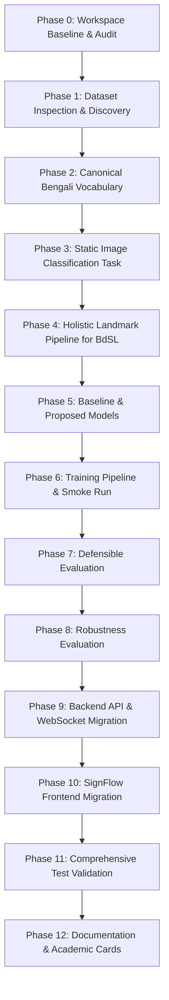

# SignFlow-BdSL Migration Plan

**Project**: SignFlow-BdSL: Robust Real-Time Bangla Sign Language Word Recognition Using Holistic Spatiotemporal Features  
**Document Version**: 1.0.0  
**Target Dataset**: BDSLW131 (29,930 still images, 131 classes in `data/raw/bangla-sign-dataset/`)  
**Target Environment**: Windows 11, Python 3.14.7, PyTorch 2.14.1+cpu, MediaPipe 1.0.1, React 18 / Vite 6  

---

## 1. Executive Migration Strategy

The migration from American Sign Language (WLASL) to Bangla Sign Language (BDSLW131) follows a phased, evidence-based protocol:

---

## 2. Phase-by-Phase Execution Plan

### Phase 0 — Establish Safe Baseline & Environment Isolation
- [x] Verify Git remote (`RiduanAziz/SignFlow-BdSL.git`), branch (`main`), and working tree.
- [x] Reinstall editable package to bind `sign-language-recognition` to `f:\SignFlow-BdSL`.
- [x] Record Python, PyTorch, OpenCV, MediaPipe, NumPy, scikit-learn, and Node versions.
- [x] Run baseline frontend tests (10/10 passed) and backend tests (59 passed, 3 pre-existing failures analyzed).
- [x] Create `docs/BDSL_MIGRATION_AUDIT.md`.
- [x] Create `docs/BDSL_MIGRATION_PLAN.md`.
- [x] Update `docs/PROJECT_STATUS.md`.

### Phase 1 — BDSLW131 Dataset Inspection & Validation
- **Objective**: Discover, validate, and index all 29,930 images across 131 classes without assumptions.
- **Key Implementation Files**:
  - `scripts/inspect_bdslw131_dataset.py`: Comprehensive dataset scanner.
    - Resolves raw directory (`data/raw/bangla-sign-dataset` or via env `BDSL_RAW_DIR`).
    - Validates image decodability using OpenCV / PIL.
    - Inspects image dimensions, color channels, corrupted files.
    - Verifies class distribution and matches with `frequency.csv` and `metadata.csv`.
    - Detects duplicates across classes.
- **Deliverables**:
  - `data/manifests/bdslw131_dataset_manifest.csv`: Clean image manifest.
  - `results/bdslw131_dataset_report.json`: Machine-readable dataset health report.
  - `results/bdslw131_class_distribution.csv`: Class frequency table.
  - `docs/BDSL_DATASET_CARD.md`: Dataset card documenting attribution, CC BY 4.0 license, and characteristics.

### Phase 2 — Target Vocabulary & Bengali Labels
- **Objective**: Establish single source of truth for 131 Bengali sign classes with Unicode and English glosses.
- **Key Implementation Files**:
  - `configs/bdslw131/vocabulary.json`: Canonical versioned vocabulary.
    - `class_id` (0..130)
    - `dataset_folder` (e.g., `ভালোবাসা_Love`)
    - `bengali_label` (e.g., `ভালোবাসা`)
    - `english_gloss` (e.g., `Love`)
    - `transliteration` (e.g., `Bhalobasha`)
  - Integration into `src/sign_language/config/`: Loading utilities that guarantee strict bijection between labels and integer IDs.

### Phase 3 — Recognition Task Specification
- **Task Determination**: **Static Image Word Classification** (Task A) + **Live Webcam Single-Sign Classification with Temporal Debouncing** (Task C).
- **Academic Limitation**: Explicitly document that BDSLW131 is an image dataset, not a continuous or dynamic video dataset. No continuous sentence translation will be falsely claimed.

### Phase 4 — Holistic Landmark Extraction & Preprocessing Pipeline
- **Objective**: Extract 553 holistic landmarks (hands: 42, pose: 33, face: 478) with anatomically sound normalization and explicit visibility masks.
- **Key Implementation Files**:
  - `scripts/extract_bdslw131_landmarks.py`: Extract landmarks from BDSLW131 JPG images to `.npz` files (`landmarks`: `[1659]`, `mask`: `[1659]`).
  - `src/sign_language/landmarks/pipeline.py`: Extend to support single-image normalization with translation and scale invariance.

### Phase 5 & 6 — Model Architecture & Training Pipeline
- **Architectures**:
  - **Baseline**: Deep MLP Classifier on static normalized holistic landmarks (`input_dim=1659`, `num_classes=131`).
  - **Proposed**: `RobustHolisticFusionClassifier` adapted for static holistic features with modality gating (hands, pose, face) and explicit visibility masks (`input_dim=1659`, `num_classes=131`).
- **Configuration Files**:
  - `configs/bdslw131/dataset.yaml`
  - `configs/bdslw131/baseline.yaml`
  - `configs/bdslw131/proposed.yaml`
- **Training Script**:
  - `scripts/train.py`: Supports BDSLW131 image dataset loading, stratified splits, checkpoint saving with embedded vocabulary mapping.
- **Validation**:
  - Small deterministic smoke training run (5 epochs on mini-batch) to prove end-to-end convergence and checkpoint saving.

### Phase 7 & 8 — Defensible Evaluation & Robustness
- **Evaluation Outputs**:
  - Top-1 accuracy, Top-5 accuracy, Macro-F1, per-class precision/recall/F1, confusion matrix.
  - `results/bdslw131_baseline_evaluation.json`
  - `results/bdslw131_proposed_evaluation.json`
  - `results/bdslw131_per_class_metrics.csv`
  - `results/bdslw131_confusion_matrix.csv`
- **Robustness**:
  - Evaluation under spatial noise, translation, and modality occlusion.
  - Verification that severity 0 is an exact identity.

### Phase 9 — Backend API & Real-Time WebSocket
- **Key Implementation Files**:
  - `src/sign_language/api/main.py`:
    - Point to BDSLW131 model checkpoints and `configs/bdslw131/vocabulary.json`.
    - Return structured JSON predictions: `bengali_label`, `english_gloss`, `confidence`, `top_k`.
  - `src/sign_language/api/inference.py`:
    - Resolve dimension mismatch (support static 1659 as well as dynamic 4977).
    - Expose vocabulary and model metadata endpoints.

### Phase 10 — Frontend Migration (SignFlow)
- **Key Implementation Files**:
  - `app/frontend/src/App.tsx`
  - `app/frontend/src/components/*`
  - Bilingual UI (Bengali & English) with proper Unicode font rendering.
  - Live prediction panel displaying Bengali word chips with English glosses.
  - Vocabulary explorer and Practice mode listing the 131 BDSLW131 words.

### Phase 11 — Test Suite & CI Validation
- Fix pre-existing dimension assertion failures.
- Add unit tests for BDSLW131 dataset manifest, Bengali Unicode handling, and vocabulary mapping.
- Run complete test suite and frontend build.

### Phase 12 — Documentation & Academic Integrity
- Update `README.md`, `docs/PROJECT_STATUS.md`, `docs/BDSL_DATASET_CARD.md`, `docs/MODEL_CARD.md`, and `docs/LOCAL_DEVELOPMENT.md`.
