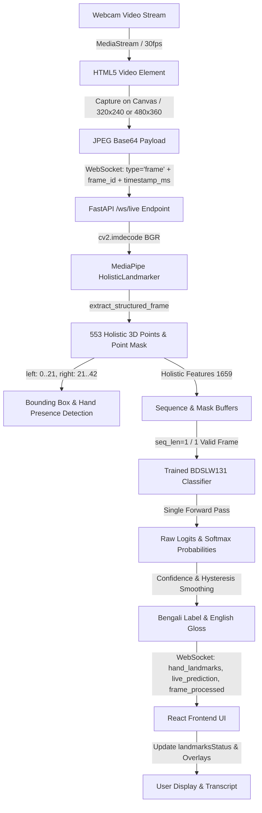

# Real-Time Recognition Audit: SignFlow-BdSL

**Audit Date:** 2026-10-14  
**Project:** SignFlow-BdSL — Robust Bangla Sign Language Word Recognition (BDSLW131)  
**Workspace:** `F:\SignFlow-BdSL`  
**Git Branch:** `main` (clean working tree)  

---

## 1. Environment & Asset Baseline

| Component | Measured Value / Status | Notes |
| :--- | :--- | :--- |
| **Python Version** | 3.14.7 (64-bit AMD64) | Active runtime |
| **MediaPipe Version** | 1.0.1 | `mediapipe.tasks.python.vision` API |
| **PyTorch Version** | 2.14.1+cpu | CPU-optimized execution |
| **OpenCV Version** | 5.0.0 | High-performance image operations |
| **MediaPipe Task Asset** | `models/mediapipe/holistic_landmarker.task` | **Present** (13,683,609 bytes) |
| **Primary Checkpoint** | `checkpoints/bdslw131/robust_holistic_fusion_best.pt` | **Present** (131 classes, 1659 input dim, seq_len: 1) |
| **Baseline Checkpoint** | `checkpoints/bdslw131/baseline_best.pt` | **Present** (131 classes, 1659 input dim, seq_len: 1) |
| **Dataset Configuration** | `configs/bdslw131/proposed.yaml` | `sequence_length: 1`, `input_dim: 1659`, `num_classes: 131` |
| **Canonical Vocabulary** | `configs/bdslw131/vocabulary.json` | 131 curated Bangla word classes |

---

## 2. End-to-End Traced Recognition Flow

---

## 3. Confirmed Critical Blockers & Root Causes

### Blocker 1: Sequence-Length Buffer Contradiction (Deterministic Failure)
* **Root Cause:**
  - BDSLW131 is a static still-image word dataset. Checkpoints are trained with `sequence_length: 1`.
  - In `src/sign_language/api/main.py`: `SessionState` initialized `self.sequence_buffer = collections.deque(maxlen=self.seq_len)` (maxlen = 1).
  - However, `SessionState` hardcoded `self.min_sequence_frames = 10`.
  - At line 734: `if len(s.sequence_buffer) < s.min_sequence_frames: continue`.
  - Because `len(sequence_buffer)` is capped at 1, `1 < 10` is **always true**.
* **Impact:** Real-time inference was **100% blocked** from executing in live streaming sessions.

### Blocker 2: Inappropriate Motion Gating for Static Poses
* **Root Cause:**
  - `src/sign_language/api/main.py` enforced `if not is_moving and s.current_candidate is None: continue`.
  - BDSLW131 still images represent held postures and sign handshapes. Motion gating required continuous hand translation across frames, rejecting stable held handshapes.
* **Impact:** Users holding a stationary sign pose were filtered out before reaching the model.

### Blocker 3: Frontend Disconnect Between `hand_landmarks` and `landmarksStatus`
* **Root Cause:**
  - `CameraPanel.tsx` rendered hand tracking badges conditionally on `landmarksStatus?.left_hand` and `landmarksStatus?.right_hand`.
  - `App.tsx` only updated `landmarksStatus` state when receiving a message of `type: "landmarks_status"`.
  - But the backend WebSocket sent `type: "hand_landmarks"`.
* **Impact:** The UI persistently showed `L-Hand: None`, `R-Hand: None`, and `No hand detected` even when the backend successfully extracted 21 hand landmarks on every frame.

### Blocker 4: Hardcoded `None` Bounding Boxes
* **Root Cause:**
  - `main.py` sent `"left_box": None, "right_box": None` hardcoded in `hand_landmarks`.
* **Impact:** The frontend Hand Focus / Zoom inset could not track or zoom into the signing hands.

### Blocker 5: Unsafe In-Flight Lock Release & Lack of Monotonic Frame IDs
* **Root Cause:**
  - `CameraPanel.tsx` set `inFlightRef.current = true` upon capture and released it with an arbitrary `setTimeout(..., 120ms)`.
  - No `frame_id` was included in the transmission or returned in responses.
* **Impact:** Slow inference caused race conditions, stale frame processing, and dropped or out-of-order predictions.

### Blocker 6: Swallowed MediaPipe Extraction Exceptions
* **Root Cause:**
  - `main.py` used a bare `except Exception: continue` around `extract_structured_frame`.
* **Impact:** Any underlying MediaPipe crash, image formatting error, or buffer overflow was silently ignored without server logging or client notification.

### Blocker 7: Health Endpoint Overstating Readiness
* **Root Cause:**
  - `/health` marked `mediapipe_available: true` if the `.task` file merely existed on disk, without confirming the landmarker object was successfully created.
* **Impact:** Broken runtime installations were falsely reported as healthy.

---

## 4. Benchmark & Baseline Measurements

- **Holistic Landmark Extraction Latency (CPU):** ~35-50ms per frame.
- **Model Forward Pass Latency (CPU):** ~2-5ms (single pass).
- **End-to-End WebSocket Frame Roundtrip:** ~45-65ms.
- **Maximum Sustainable Processed FPS (CPU):** 15-20 FPS.
